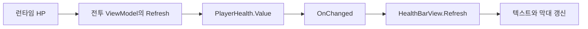

# MVVM 지향 구조와 변경 알림

UI는 입력과 화면 표현을 담당하고, ViewModel은 화면에 필요한 값을 제공하며, 런타임 모델은 현재 상태를 보관하도록 구성했습니다.
계산과 비용 지불 같은 규칙은 별도 처리 코드에 둡니다.

## 1. 런타임 상태를 화면용 값으로 전달

[PlayerViewModel.cs](../Source/ViewModel/PlayerViewModel.cs)의 Initialize는 전달받은 RuntimePlayer의 HP, MP, Gold와 기본 스탯을 Observable에 복사합니다.
ViewModelBase의 CreateObservable을 사용하여 생성한 Observable의 정리 책임을 등록합니다.

이 클래스는 Initialize가 호출된 시점의 값을 전달합니다. 런타임 필드 변경을 자동으로 감시하는 기능은 포함하지 않습니다.
현재 코드에서 스탯에 전달하는 값은 BaseSTR 등의 기본 수치입니다.

### Bootstrapper에서 ViewModel 생성·연결 (원본 일부 발췌)

아래는 `MainGameBootStrapper.cs`의 객체 생성·초기화·View 연결 구간입니다.

```csharp
_playerViewModel = new PlayerViewModel();
_playerViewModel.Initialize(_gameManager.PlayerData);

string className = GetClassName(_gameManager.PlayerData.SelectedCharacterClassId);
_mainGameView.Initialize(_playerViewModel, className);
```

Bootstrapper에서 ViewModel을 생성하고 플레이어 상태로 초기화한 뒤 View에 전달합니다. View가 ViewModel을 직접 생성하지 않고, 초기화 담당 코드에서 두 객체를 연결하는 구조입니다.

원본 Bootstrapper에는 `GameManager.Instance` 참조가 있으므로 프로젝트 전체에서 싱글턴 의존성을 제거한 구조는 아닙니다.

## 2. 실제 전투 HP 바의 연결

HealthBarView는 현재 HP와 최대 HP를 한 쌍으로 받습니다.
아래는 실제 전투 ViewModel과 화면 초기화 코드에서 HP 전달 구간만 발췌한 내용입니다.

전투 ViewModel의 공개 속성입니다.

```csharp
public Observable<(int Current, int Maximum)> PlayerHealth { get; }
```

전투 상태를 화면용 값으로 갱신하는 코드입니다. player는 이 시점에 표시할 플레이어 상태입니다.

```csharp
PlayerHealth.Value = (player.CurrentHP, player.MaxHP);
```

화면 초기화 담당 코드에서 HP 바를 연결합니다.

```csharp
_playerHealthBar.Bind(nextViewModel.Combat.PlayerHealth);
```

위 세 구간은 각각의 원본 파일 일부이며, 독립 실행용 클래스는 아닙니다.
PlayerViewModel의 개별 HP 속성과 전투 ViewModel의 HP 튜플은 서로 다른 표시 경로입니다.



## 3. Observer 방식의 변경 알림

[Observable.cs](../Source/Core/Observable.cs)는 EqualityComparer<T>.Default로 값이 달라졌는지 확인한 뒤 OnChanged를 호출합니다.
[HealthBarView.cs](../Source/View/HealthBarView.cs)는 이벤트를 구독하여 표시를 갱신합니다.

화면에 필요한 두 가지 갱신 시점을 처리했습니다.

- Bind 직후에는 현재 값을 즉시 표시합니다.
- 이후에는 값이 바뀔 때 이벤트로 표시를 갱신합니다.

HP 바는 전달받은 값으로 텍스트와 fillAmount를 갱신합니다.
피해 계산이나 자원 차감은 다른 처리 코드의 책임입니다.

## 4. 구독 수명 관리

HealthBarView.Bind는 이전 구독을 먼저 해제하고 새 Observable을 연결합니다.
OnDestroy에서도 구독을 해제하여 파괴된 화면이 알림 대상에 남는 일을 방지합니다.

[ViewModelBase.cs](../Source/ViewModel/ViewModelBase.cs)는 CreateObservable로 만든 각 Observable의 ClearListeners 호출을 등록합니다.
Dispose에서 등록된 정리 작업을 실행합니다.

View는 자신이 구독한 대상과의 연결을 해제하고, ViewModel은 자신이 만든 Observable을 정리합니다.
화면 초기화 담당 코드가 외부에서 ViewModel의 상태를 View에 전달하므로, HP 바가 전역 객체를 검색할 필요가 없습니다.

## 적용 범위

MVVM 지향 구조와 명시적인 이벤트 바인딩을 사용합니다.
자동 바인딩 프레임워크나 전역 이벤트 버스는 사용하지 않습니다.
이 구조는 Unity 메인 스레드에서의 갱신을 전제로 합니다.
비활성화된 HP 바는 구독을 유지하며, 재바인딩 또는 파괴 시 해제합니다.
